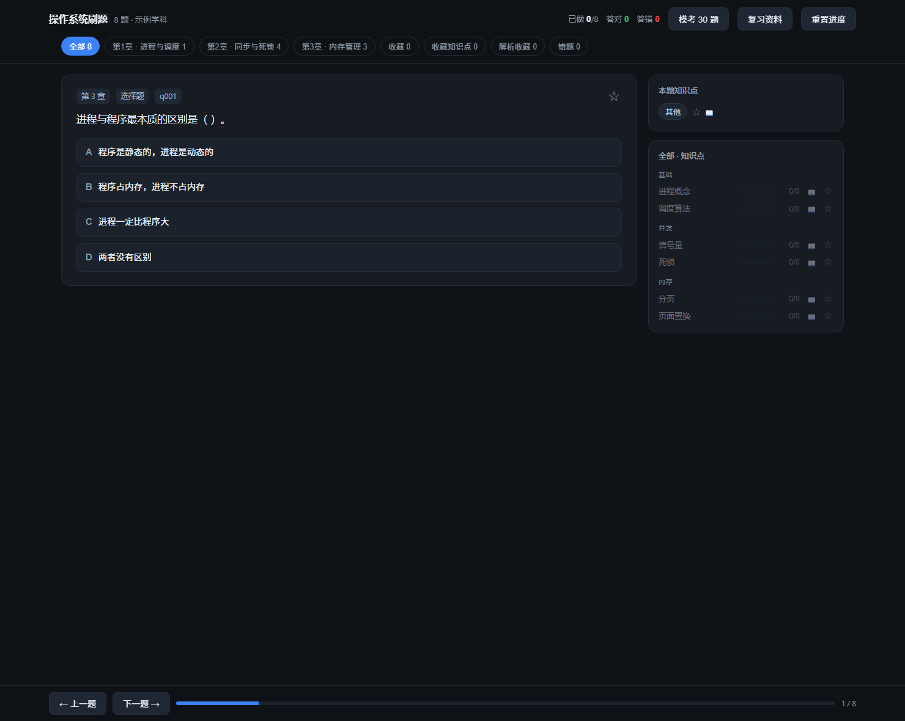
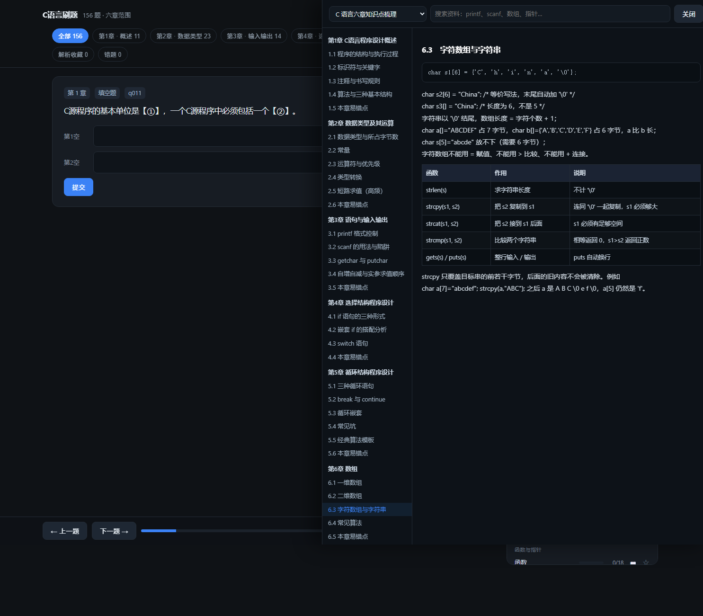
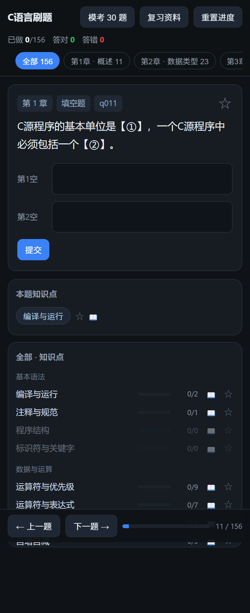

# 复习页面生成器（quiz-kit）

把一份题库 + 一份讲义，变成**双击就能用的刷题页面**，还能装到手机上离线用。

- 纯静态：生成的页面是单个 HTML，不需要服务器、数据库和登录；
- 离线可用：打包成 PWA 后可安装到桌面 / 手机主屏，断网也能刷；
- 自带判分：选择题点选即判、填空题逐空判分 + 申诉、简答/编程题对照参考答案自评；
- 复习闭环：错题本（连对 2 次才移出）、题目/知识点/解析三处收藏、30 题限时模考、章节与知识点筛选；
- 讲义同屏：资料抽屉按章节浏览，题目旁的 📖 直接跳到对应小节，支持代码块与表格。

**在线试用：<https://liis-cloud.github.io/quiz-kit/>** （示例题库，可直接装到手机主屏）







## 快速开始

需要 Python 3.9+（只有生成 PWA 图标时才用到 Pillow）。

```bash
git clone https://github.com/<you>/quiz-kit.git
cd quiz-kit

# 1. 构建示例页面（自带操作系统示例题库 + 示例讲义）
python kit/build_site.py examples/subject.example.json --pwa

# 2. 打开 examples/out/demo.html 就能刷题
# 3. 想装 PWA：本地必须走 http
cd examples && python -m http.server 8811   # 浏览器打开 http://127.0.0.1:8811/pwa/
```

换自己的科目只需要两个文件：

```
my-course/
├─ quiz_bank.json      # 题库
└─ subject.json        # 学科配置（照抄 examples/subject.example.json 改）
```

```bash
python kit/build_site.py my-course/subject.json --pwa
```

## 题库模板：把资料直接变成题库

`kit/bank_template.md` 是给人（或 AI）用的填空模板：照它的格式抄一遍，或者直接把资料丢给 AI，让它按这个格式整理，再跑一句命令就得到题库。

```bash
python kit/make_bank.py 我的题库.md -o my-course/quiz_bank.json
# Word 文档同样支持（在 Word 里照模板排版即可）
python kit/make_bank.py 我的题库.docx -o my-course/quiz_bank.json
```

格式要点：

```markdown
## 1 | 第1章 | 选择题
进程与程序最本质的区别是（ ）。
A. 程序是静态的，进程是动态的
B. 程序占内存，进程不占内存
答案：A
解析：程序是磁盘上的静态指令集合；进程是程序的一次执行。

## 2 | 第2章 | 填空题
信号量初值为 3，5 次 P 操作后是 ____。
答案：0

## 3 | 第3章 | 简答题
简述快表（TLB）的作用。
答案：把最近用到的页表项放进高速缓存，命中时只需一次访存……
```

- `## 题号 | 第X章 | 题型`：题号和题型都能省，章节省略时用 `--chapter` 统一指定；
- 选择题答案写字母；判断题写 `A. √ 正确` / `B. × 错误` 或直接「答案：正确」；
- 填空题用 `____` 或 `【①】` 标空位，答案按空用「；」隔开；
- 简答/编程题的答案写在「答案：」下面，可以多行、可以贴代码块；
- 「解析：」可选，会显示在答案解析里；
- 题型不写时按「有选项 → 选择；有空位 → 填空；否则简答」自动判定。

## 题库格式

```json
[
  {
    "id": "q001",
    "ch": 1,
    "type": "choice",
    "text": "进程与程序最本质的区别是（ ）。",
    "opts": [{"k": "A", "t": "程序是静态的，进程是动态的"}, {"k": "B", "t": "……"}],
    "correct": ["A"],
    "exp": "解析文字（可选，显示在答案解析里）"
  }
]
```

| `type` | 用作 | 需要的字段 |
| --- | --- | --- |
| `choice` | 选择 / 判断 | `opts` + `correct`（正确项字母数组）；判断题写成两个选项即可 |
| `fill` | 填空 | `blank`（空数）+ `parts`（每空答案数组），逐空比对 |
| `subj` | 简答 / 编程 | `answer`（参考答案文本，可含代码块） |

其它可选字段：`ch`（章节号）、`kp`（知识点数组，留空则由配置规则自动打）、`exp`（解析）。

从现成资料自动抽题：

```bash
python kit/extract.py 题目.txt -o my-course/quiz_bank.json --chapter 1
```

支持「正确答案：X」和「答案：X」两种排版；抽歪的部分手改 JSON 就行。

## 学科配置

`subject.json` 的字段（都有默认值，只写需要的）：

| 字段 | 说明 |
| --- | --- |
| `name` / `short` | 页面标题 / 手机主屏名字 |
| `dir` | 工作目录（相对配置文件的路径） |
| `out` | 输出的 HTML 路径（相对 `dir`） |
| `bank` | 题库文件 |
| `storage_key` | 浏览器里存进度的键，不同科目要不同 |
| `chapters` | `[{"n":1,"label":"第1章 · 进程"}]`，生成顶部章节标签 |
| `chapter_rules` | `[["正则", 章节号]]`，按顺序命中，用于自动分章 |
| `kp_groups` | `[["分组名", ["知识点1","知识点2"]]]`，决定侧栏分组 |
| `kp_rules` | `[["正则", "知识点名"]]`，自动打知识点 |
| `kp_secondary` | `{"regex":"…","add":"…"}`，命中时追加第二个知识点 |
| `docs` | `[{"id","title","file","kind"}]`，讲义文件列表（`kind`: `res` 讲义 / `lab` 实验报告） |
| `docs_file` | 直接读已生成的 `docs.json`（替代 `docs`） |
| `kp_doc` | 知识点 → 讲义小节 id，控制 📖 跳转位置 |
| `extra_tabs` | 额外标签，一般保持 收藏 / 收藏知识点 / 解析收藏 / 错题 |
| `cleaner` | `none`（已清洗）/ `ds` / `pta`（两种原始题库格式自动清洗） |
| `pwa_dir` / `cache` | PWA 输出目录 / Service Worker 缓存名（改内容时换个名字可强制更新） |
| `icon_label` / `icon_color` | 手机图标上的字与强调色 |

## 讲义抽屉

`docs.py` 把讲义切成小节供抽屉显示，识别这些标题：

- `第 1 章 xxx` / `第1章 xxx` → 一级
- `1.1 xxx` → 二级
- `附录 A xxx` / `B.1 xxx` → 附录
- 含 ` | ` 的行当表格，`#include` / `for(` / `;` 等当代码块

实验报告（`kind: "lab"`）按「实验目的 / 实验内容 / 实验结果 …」切块。

## 发布到 GitHub Pages

```bash
python kit/publish.py my-course/subject.json
```

它会创建 `<id>-quiz` 仓库、用 Contents API 上传 PWA 目录、开启 Pages 并轮询到 200。
走 API 而不是 `git push`，是因为部分网络环境下 `github.com:443` 直连不通。

需要 `gh` 已登录（`gh auth login`），或在配置里写 `owner`，或设环境变量 `GH_OWNER`。

## 常见问题

**双击 HTML 打开正常，但装不了 PWA？**
Service Worker 只允许在 `https://` 或 `localhost/127.0.0.1` 下注册。本地用 `python -m http.server` 起服务再访问，或直接发布到 Pages。

**手机上还是旧版本？**
生成时把配置里的 `cache` 改成新名字（如 `osquiz-v2`），重新发布；手机上下拉刷新或重开标签页。

**章节/知识点自动打错了？**
`chapter_rules`、`kp_rules` 是「正则 → 结果」的顺序规则，先命中先用；把更具体的规则放前面，或者直接在题库里写死 `ch` / `kp`。

**题目几千道会不会卡？**
页面是纯前端数组 + 按需渲染，几千道没问题；单文件体积大主要是讲义内联（含图片时尤其明显），可以把 `docs` 拆成单独文件按需加载。

## 目录

```
kit/
  build_site.py   主构建：清洗题库 → 分章分知识点 → 套模板 → 输出 HTML / PWA
  app.js          前端逻辑（判分、错题、收藏、模考、资料抽屉）
  template.html   页面外壳
  docs.py         讲义 → 章节结构
  pwa.py          manifest / Service Worker / 图标
  extract.py      资料文本 → 题库
  publish.py      上传 GitHub Pages
examples/
  bank.example.json     8 道示例题（操作系统）
  subject.example.json  示例配置
  material.example.md   示例讲义
docs/             截图
```

## License

MIT
